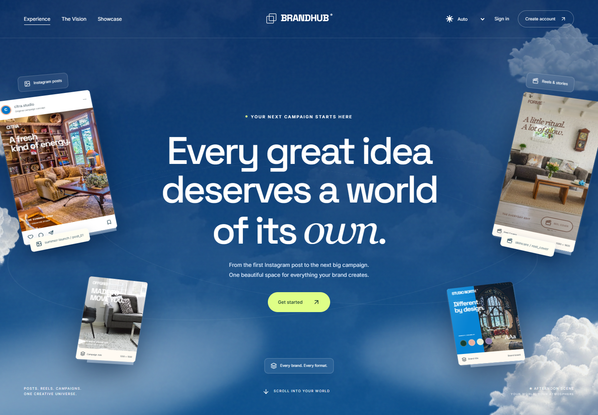
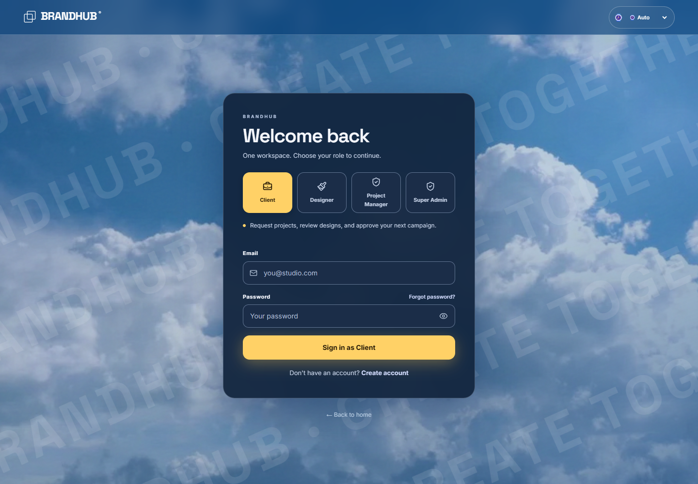

<div align="center">

# 🎨 BrandHub — Creative Asset Management

**Creative Asset Management & Collaboration**

A shared workspace for creative briefs, project delivery, asset reviews, and client approvals.

<br/>


<br/>

**[🌐 Open BrandHub](https://brandhub-creative-asset-management.vercel.app/)** · **[🔐 Sign in](https://brandhub-creative-asset-management.vercel.app/login)**


[Getting started](#getting-started) · [Screenshots](#screenshots) · [Login accounts](#login-accounts) · [Configuration](#configuration) · [Deployment](#deployment)

</div>

---

<a id="overview"></a>

## 🎯 Overview

BrandHub is a full-stack internship prototype that brings Super Admins, Project Managers, Designers, and Clients into one creative workflow. Clients submit briefs, management assigns work, designers upload deliverables, and clients review revisions in the context of their own projects.

**Website:** [brandhub-creative-asset-management.vercel.app](https://brandhub-creative-asset-management.vercel.app/)

The application includes a public landing page, authenticated role-based workspaces, a media library, dashboard analytics, and downloadable management reports. Payments are explicitly simulated; no real funds move or payment credentials are collected. Deployment and email delivery require separate verification in the target environment.

---

<a id="contents"></a>

## 📌 Contents

- [Features](#features)
- [Screenshots](#screenshots)
- [Roles and permissions](#roles-and-permissions)
- [Technology and architecture](#technology-and-architecture)
- [Getting started](#getting-started)
- [Configuration](#configuration)
- [Login accounts](#login-accounts)
- [Creative workflow](#creative-workflow)
- [Application routes](#application-routes)
- [API overview](#api-overview)
- [Project structure](#project-structure)
- [Development commands](#development-commands)
- [Testing and verification](#testing-and-verification)
- [Deployment](#deployment)
- [Troubleshooting](#troubleshooting)
- [Documentation and contribution](#documentation-and-contribution)
- [Project status and license](#project-status-and-license)

---

<a id="features"></a>

## ✨ Features

| Area | Capabilities |
| --- | --- |
| Public experience | Campaign landing page, creative gallery, local photography/video assets, and responsive layouts. |
| Authentication | Role selection, session-based login, Client signup, password-change and recovery screens, and account settings. |
| Administration | One Super Admin, privileged account administration, Project Manager team management, and account activation controls. |
| Briefs and requests | Client contact details, company, description, proposed INR amount, and management approval decisions. |
| Project delivery | Client ownership, designer assignment, project details, status tracking, search, and filtering. |
| Creative assets | Authorized uploads, previews, revisions, submission for review, and approval/change-request history. |
| Collaboration | Asset comments, review queues, and personal bookmarks. |
| Media library | Project-scoped images and videos, supplied static demo media, and GridFS-backed uploads. |
| Analytics | Scoped project counts, design-stage charts, approval progress, and designer workload views. |
| Reports | Management summaries and branded PDF exports filtered by year/month. |
| Payment simulation | Demo UPI/card/bank checkout, simulated declines, and persisted receipts after approval. |
| Appearance | Morning, afternoon, sunset, and night atmosphere themes with desktop and mobile navigation. |

---

<a id="screenshots"></a>

## 📸 Screenshots

### Landing page



### Login page

Select Client, Designer, Project Manager, or Super Admin and enter your credentials manually. Demo autofill controls have been removed.



---

<a id="roles-and-permissions"></a>

## 👥 Roles and permissions

| Role | Stored value | Main responsibilities |
| --- | --- | --- |
| Super Admin | `super_admin` | Oversee the workspace, manage privileged accounts, and access management functions. A partial unique database index limits this role to one account. |
| Admin / Project Manager | `project_manager` | Manage projects, assign designers, approve briefs, manage basic team accounts, and export reports. |
| Designer | `designer` | Work on assigned projects, upload deliverables and revisions, and respond to review feedback. |
| Client | `client` | Submit briefs, view owned projects, review designs, comment, and complete simulated checkout on eligible approved requests. |

The former Admin role is represented by `project_manager`. Choosing a role on the login form does not grant access: the API checks the stored account role and project membership. Super Admin inherits management permissions. Clients and Designers receive scoped project data.

---

<a id="technology-and-architecture"></a>

## 🏗️ Technology and architecture

| Layer | Implementation |
| --- | --- |
| Frontend | React 19, TypeScript, React Router 7, Vite 7, Tailwind CSS 4, GSAP, Lucide icons, Axios. |
| Backend | Node.js, Express 5, Mongoose 9, Zod validation, and PDFKit reports. |
| Database | MongoDB for application records, MongoDB-backed sessions, and GridFS file storage. |
| Optional storage | Cloudinary support for legacy asset records and configured storage flows. |
| Security | Password hashing with bcryptjs, HTTP-only session cookies, CSRF checks, Helmet headers, rate limits, and server-side authorization. |
| Verification | ESLint, TypeScript, Node test runner, Supertest, mongodb-memory-server, and Playwright browser scripts. |
| Packaging | npm workspaces for `client/` and `server/`; Vercel configuration for same-origin hosting. |

```text
Browser / React
    | /api (Vite proxy locally; same-origin function on Vercel)
Express API
    |-- MongoDB: users, projects, requests, assets, comments, sessions
    |-- GridFS: uploaded files
    |-- Optional Cloudinary: legacy/configured storage
    `-- PDFKit: generated management reports

client/public/demo-media/ --> supplied static images and videos
```

---

<a id="getting-started"></a>

## 🚦 Getting started

### Prerequisites

- Git, npm, and a current Node.js LTS version compatible with Vite 7 and Mongoose 9. Node.js 22.12+ is a suitable baseline; this repository does not pin an engine version.
- A local MongoDB service or an Atlas development database for persistent operation.
- A modern browser. Browser audit scripts additionally need an installed Chromium-compatible browser.

### 1. Install the project

```bash
git clone https://github.com/tirthgandhi/BrandHub-Creative-Asset-Management.git
cd BrandHub-Creative-Asset-Management
npm ci
```

Run commands from the repository root unless a different directory is specified.

### 2. Configure the server

PowerShell:

```powershell
Copy-Item server/.env.example server/.env
```

macOS/Linux:

```bash
cp server/.env.example server/.env
```

If `server/.env` already exists, edit it instead of overwriting it. Set `MONGODB_URI`, replace `SESSION_SECRET` with at least 32 random characters, and use `CLIENT_URL=http://127.0.0.1:5173` for the URLs below. The server workspace loads **`server/.env`**, not a root `.env` file.

### 3. Start the API and frontend

Terminal 1:

```bash
npm run dev:server
```

Terminal 2:

```bash
npm run dev:client
```

- Frontend: <http://127.0.0.1:5173>
- API health: <http://127.0.0.1:5000/api/health>
- Login: <http://127.0.0.1:5173/login>

Vite proxies `/api` requests to port 5000. Keep the same hostname in the browser and `CLIENT_URL`. If Vite chooses another port, update `CLIENT_URL` and restart the API.

### 4. Create an initial management account

Set `ADMIN_EMAIL`, `ADMIN_PASSWORD`, and `ADMIN_NAME` in `server/.env`, then run:

```bash
npm run seed:admin
```

This creates a Project Manager using the configured credentials and does not replace an existing account. Follow any required password-change prompt after signing in. Public signup creates Client accounts; it does not create privileged users.

### Optional: disposable local preview

```bash
npm run dev:preview-api
```

Run this **instead of** the normal API on port 5000, alongside `npm run dev:client`. It starts an isolated temporary MongoDB instance and a Project Manager account: `admin@brandhub.demo` / `AdminPass123`. The first run may download a MongoDB binary. Preview data is disposable and does not include the full four-role catalog.

---

<a id="configuration"></a>

## ⚙️ Configuration

[Root environment example](.env.example) explains client overrides and provides a server configuration reference. [Server environment example](server/.env.example) is the template to copy for actual API startup.

| Variable | Purpose / local value |
| --- | --- |
| `NODE_ENV` | `development`, `test`, or `production`. |
| `PORT` | API port; default `5000`. |
| `CLIENT_URL` | Exact allowed frontend origin, such as `http://127.0.0.1:5173`. |
| `MONGODB_URI` | Private MongoDB connection string, including the development database name. |
| `SESSION_SECRET` | Private random session secret, at least 32 characters. |
| `COOKIE_NAME` | Session cookie name; `brandhub_session`. |
| `COOKIE_SECURE` | `false` for local HTTP; `true` for production HTTPS. |
| `COOKIE_SAME_SITE` | `lax` for same-site hosting; cross-site deployment may require `none` and secure cookies. |
| `ASSET_STORAGE` | `gridfs` for the prototype upload backend. |
| `MEDIA_IMAGE_MAX_BYTES` | Default image upload limit: `5242880` (5 MiB). Hosting limits may be lower. |
| `MEDIA_VIDEO_MAX_BYTES` | Default video upload limit: `20971520` (20 MiB). Hosting limits may be lower. |
| `GRIDFS_UPLOAD_BUDGET_BYTES` | GridFS upload budget: `262144000` (250 MiB). |
| `CLOUDINARY_CLOUD_NAME`, `CLOUDINARY_API_KEY`, `CLOUDINARY_API_SECRET` | Optional server-only credentials for Cloudinary storage. |
| `CLOUDINARY_ASSET_FOLDER` | Cloudinary folder, e.g. `brandhub/development`. |
| `CLOUDINARY_SIGNED_URL_TTL_SECONDS` | Signed URL lifetime; example `300` seconds. |
| `ADMIN_EMAIL`, `ADMIN_PASSWORD`, `ADMIN_NAME` | Initial account seed configuration. |
| `DEMO_USER_PASSWORD` | Password used when creating catalog demo users. |
| `ALLOW_SEED`, `SEED_ADMIN_EMAIL`, `SEED_ADMIN_PASSWORD` | Additional gates/settings used by historical seed/import tooling; not all scripts use them. |
| `VITE_API_URL` | Public API base URL; defaults to `/api`. |
| `VITE_API_PROXY_TARGET` | Optional Vite development proxy override; default `http://127.0.0.1:5000`. |

Client overrides belong in **`client/.env.local`**. A same-origin setup needs no client environment file. Never put MongoDB, session, or Cloudinary secrets in `VITE_` variables: those values are public browser configuration.

---

<a id="login-accounts"></a>

## 🔐 Login accounts

The following fictional accounts belong to the prepared prototype dataset. Select the matching role and enter the email/password manually. A new database does not contain these accounts until seeded.

| Login role | Email | Prepared prototype password |
| --- | --- | --- |
| Super Admin | `superadmin@brandhub.example` | `Brand123` |
| Admin / Project Manager | `admin@brandhub.example` | `Brand123` |
| Designer | `nisha.verma@brandhub.example` | `Brand123` |
| Client | `iris.vale@brandhub.example` | `Brand123` |

These published credentials are for a controlled demonstration dataset only. Use private, distinct credentials for an actual deployment. Setting `ADMIN_PASSWORD` alone does not change an existing user's password.

### Prepare the full prototype dataset

Use a dedicated **non-production Atlas database named `brandhub_demo`**. The catalog seed enforces the database name and Atlas hostname. Configure its URI plus strong `ADMIN_PASSWORD` and `DEMO_USER_PASSWORD` values in `server/.env`.

```bash
npm run seed:brandhub:dry-run --workspace server
npm run seed:brandhub --workspace server
npm run verify:brandhub-seed --workspace server
```

Then, from `server/`:

```bash
node scripts/seedPrototypeRoles.js
node scripts/prototypeWorkflow.js
```

The role script migrates legacy Admin roles, invalidates affected sessions, and ensures the single Super Admin. The workflow script resets catalog account passwords to `Brand123` and prepares a request/review example. These commands change the demo database; run them only against your own dedicated demonstration dataset. They are not part of normal application startup.

---

<a id="creative-workflow"></a>

## 🔄 Creative workflow

1. **Client submits a brief:** include the project description, contact details, company, and proposed INR amount.
2. **Management reviews the request:** approve the brief and assign designers to the resulting project.
3. **Designer creates deliverables:** upload an asset to an assigned project and submit it for review.
4. **Client reviews the design:** approve it or request changes, with comments tied to the asset/version.
5. **Designer revises:** upload a new revision and resubmit until approval.
6. **Client uses simulated checkout:** eligible approved requests with an amount support a successful or declined demo payment. A saved receipt remains available after reload.
7. **Management tracks delivery:** use scoped dashboards, review queues, and period-based PDF reports.

Supplied demo photos/videos live in `client/public/demo-media/`. New uploads use GridFS when configured; existing Cloudinary-backed records remain supported. Designer deliverables also support document formats including PDF, DOCX, XLSX, PPTX, TXT, CSV, and ZIP, subject to endpoint validation and hosting limits.

---

<a id="application-routes"></a>

## 🧭 Application routes

| Route | Purpose |
| --- | --- |
| `/` | Public landing page. |
| `/login`, `/signup` | Sign in and Client registration. |
| `/forgot-password`, `/reset-password`, `/verify-email`, `/change-password` | Account recovery, verification, and password screens. |
| `/app/dashboard` | Role-scoped overview and analytics. |
| `/app/projects`, `/app/projects/:id` | Project list and details. |
| `/app/projects/new`, `/app/projects/:id/edit` | Management project creation/editing. |
| `/app/assets`, `/app/assets/:id`, `/app/assets/upload` | Creative assets, revisions, reviews, and authorized uploads. |
| `/app/media`, `/app/media/upload` | Media library and authorized uploads. |
| `/app/requests`, `/app/requests/new` | Client briefs. |
| `/app/management/requests` | Management request queue. |
| `/app/management/users` | Project Manager team administration. |
| `/app/super-admin/users` | Super Admin privileged account administration. |
| `/app/reviews`, `/app/bookmarks` | Review queues and saved assets. |
| `/app/reports` | Management PDF reports. |
| `/app/profile`, `/app/settings` | Account and workspace preferences. |

Legacy `/app/admin/users` and `/app/admin/requests` redirect to management routes. Access remains subject to authentication, role, and project membership.

---

<a id="api-overview"></a>

## 🔌 API overview

All API routes use the `/api` prefix. Protected requests require a session cookie; authenticated mutations also use the CSRF token supplied by the authentication flow.

| API group | Responsibility |
| --- | --- |
| `GET /api/health` | API status and database state. |
| `/api/auth` | Registration, login, session, password, and logout operations. |
| `/api/users` | Authorized account administration. |
| `/api/projects` | Project queries, creation, assignment, and updates. |
| `/api/project-requests` | Client briefs, management decisions, and simulated payments. |
| `/api/assets` | Deliverables, revisions, review actions, comments, and bookmarks. |
| `/api/media` | Media metadata, uploads, and delivery. |
| `/api/comments`, `/api/bookmarks` | Collaboration resources. |
| `/api/dashboard` | Scoped counts and analytics. |
| `/api/reports/summary` | Management report data. |
| `/api/reports/workspace.pdf` | PDF download; optional `year` and `month` query parameters. |

See the [API contract](docs/api/API_CONTRACT.md) for the original endpoint conventions and the [route implementations](server/src/routes/) for current behavior. Historical contracts may predate later prototype additions.

---

<a id="project-structure"></a>

## 📂 Project structure

```text
BrandHub-Creative-Asset-Management/
|-- client/
|   |-- public/           # Static media, themes, and public assets
|   |-- src/
|   |   |-- components/   # Shared UI, layouts, dashboards, asset controls
|   |   |-- config/       # Role labels and access helpers
|   |   |-- context/      # Authentication state
|   |   |-- pages/        # Auth, projects, assets, media, requests, reports
|   |   |-- routes/       # Application routing and protected routes
|   |   |-- services/     # API clients
|   |   `-- styles/       # Themes and workspace styling
|   `-- tests/            # Unit checks and browser audits
|-- server/
|   |-- scripts/          # Initial accounts, demo seeds, media tools, preview
|   |-- src/
|   |   |-- config/       # Environment, database, sessions, Cloudinary
|   |   |-- middleware/   # Authentication, CSRF, limits, error handling
|   |   |-- models/       # MongoDB models
|   |   |-- routes/       # Express endpoints
|   |   |-- services/     # Access, storage, reports, workflow logic
|   |   `-- validation/   # Request schemas
|   |-- tests/            # API, authorization, and workflow tests
|   `-- server.js         # Persistent server startup
|-- server/index.js      # Vercel Express entry point
|-- docs/                 # Contracts, screenshots, design and QA records
|-- .env.example          # Environment reference
|-- package.json          # Workspace commands
`-- vercel.json           # Root build and routing configuration
```

---

<a id="development-commands"></a>

## 💻 Development commands

| Command | Purpose |
| --- | --- |
| `npm ci` | Install the locked workspace dependencies. |
| `npm run dev:client` | Start Vite; `npm run dev` is a client-only alias. |
| `npm run dev:server` | Start the API with Node watch mode. |
| `npm run start:server` | Start the API without watch mode. |
| `npm run dev:preview-api` | Start the disposable database/API preview. |
| `npm run lint` | Lint both workspaces. |
| `npm run typecheck` | Run the client TypeScript check. |
| `npm test` | Run client and server tests. |
| `npm run test:server` | Run server tests only. |
| `npm run build` | TypeScript build and Vite production bundle in `client/dist/`. |
| `npm run preview` | Preview the built frontend; run the API separately. |
| `npm run seed:admin` | Create the configured initial Project Manager. |

Additional media preparation and catalog seed commands are defined in [server/package.json](server/package.json).

---

<a id="testing-and-verification"></a>

## 🧪 Testing and verification

Run the standard checks before submitting code:

```bash
npm run lint
npm run typecheck
npm test
npm run build
```

API tests use isolated MongoDB test instances through `mongodb-memory-server`; a first run may need network access to download MongoDB. Tests should never target a shared production database.

Browser audits live in `client/tests/browser/`. They accept `BRANDHUB_TEST_URL` and `BRANDHUB_BROWSER`, need the prepared four-role dataset and documented workflow examples, and now enter credentials through the regular login fields. Set the URL explicitly because script defaults vary.

PowerShell example:

```powershell
$env:BRANDHUB_TEST_URL = "http://127.0.0.1:5173"
$env:BRANDHUB_BROWSER = "C:/Program Files (x86)/Microsoft/Edge/Application/msedge.exe"
node client/tests/browser/role-audit.mjs
node client/tests/browser/analytics-audit.mjs
```

Interaction and payment audits are also available. Payment tests create demonstration requests and receipts, so use a dedicated test dataset. Historical [test reports](docs/testing/) record earlier verification; they are not proof that a new deployment has passed.

---

<a id="deployment"></a>

## 🚀 Deployment

### Vercel: same-origin frontend and API

**Project URL:** [Open BrandHub](https://brandhub-creative-asset-management.vercel.app/).

1. Import the repository as one Vercel project with the repository root as Root Directory. The root `vercel.json` declares the `client` Vite service and `server` Express service.
2. The client builds to `client/dist`; `server/index.js` initializes the API. Public `/api/*` requests reach the server with their prefix intact. No internal service binding is required.
3. Set Production environment variables in Vercel: `MONGODB_URI`, `SESSION_SECRET` (at least 32 characters), `NODE_ENV=production`, `ASSET_STORAGE=gridfs`, `COOKIE_SECURE=true`, and `COOKIE_SAME_SITE=lax`.
4. Set `CLIENT_URL=https://brandhub-creative-asset-management.vercel.app`. Keep `VITE_API_URL=/api` or leave it unset. Do not expose server secrets in browser variables.
5. Set image, video, and document upload limits below the host request limit; keep multipart uploads below 4 MB. Static supplied media is served by the client.
6. Allow the deployment to connect in Atlas Network Access, confirm database-user permissions, and redeploy after changing environment values.
7. Verify `/api/health`, login/logout, session persistence, uploads, reports, nested-route refresh, and role isolation on the actual deployment.

See [Vercel services guide](docs/deployment/VERCEL_SERVICES.md) and [.env.vercel.example](.env.vercel.example) for configuration details. The former root API wrapper is no longer used.

### Separate frontend and persistent API

Build the frontend with `npm run build` and run the backend with `npm run start:server` on a Node host. Set `VITE_API_URL` to the public backend URL ending in `/api` before building the frontend. Set `CLIENT_URL` to the exact frontend origin. For genuinely cross-site cookies, use HTTPS, `COOKIE_SECURE=true`, and `COOKIE_SAME_SITE=none`, then verify actual browser behavior.

The earlier [deployment guide](docs/deployment/PHASE2_DEPLOYMENT.md) contains historical phase notes. The root Vercel configuration and services guide describe the current deployment path. The website link is provided above; end-to-end production acceptance remains a separate check.

---

<a id="troubleshooting"></a>

## 🔧 Troubleshooting

### Signup/login: database temporarily unavailable

This response means API initialization failed; the original handler also used it for missing or invalid configuration. It does not indicate an invalid signup form.

1. In Vercel **Project Settings → Environment Variables**, confirm `MONGODB_URI` is configured for **Production**, points to the intended database, and contains a valid Atlas database username/password. URL-encode special characters in connection-string credentials.
2. Set `SESSION_SECRET` to a private random value of at least 32 characters. Do not copy the placeholder from an example file.
3. In Atlas, confirm the cluster is running, the database user has access, and Network Access permits the Vercel deployment's connections.
4. Set `CLIENT_URL` to the actual HTTPS site origin and use secure cookies. Redeploy after environment changes.
5. Check Vercel server runtime logs and `/api/health`. Retry signup only after the API is healthy. Never paste the connection string or session secret into a public issue.


| Symptom | What to check |
| --- | --- |
| API refuses to start | Confirm `server/.env` exists, MongoDB is reachable, and `SESSION_SECRET` has at least 32 characters. |
| API calls fail from the frontend | Confirm port 5000 is running and the Vite proxy points to the correct API host/port. |
| Login succeeds but the session does not persist | Use the same browser hostname as `CLIENT_URL`; check cookie secure/same-site settings and HTTPS. |
| Login returns a role mismatch | Select the account's stored role. Admin accounts use Project Manager. |
| Published prototype credentials do not work | Confirm the correct database was seeded and the prototype workflow password reset was run; ordinary seed passwords come from your environment. |
| Dashboard shows no projects | New databases are empty; create/assign projects or prepare the demo catalog. Account visibility is intentionally scoped. |
| Upload fails on Vercel | Check both application size limits and the host request limit; keep prototype uploads below 4 MB. |
| Browser audit cannot launch | Set `BRANDHUB_BROWSER` to an installed Chromium-compatible executable. |
| MongoDB test/preview download fails | Check network access or configure a locally cached supported MongoDB binary. |
| Recovery screen does not send email | Email delivery has not been verified; configure and test a delivery integration before relying on recovery in production. |

---

<a id="documentation-and-contribution"></a>

## 🤝 Documentation and contribution

- [Contribution rules and review workflow](CONTRIBUTING.md)
- [API contract](docs/api/API_CONTRACT.md)
- [Storage and hybrid media notes](docs/HYBRID_MEDIA.md)
- [UI atmosphere specification](docs/ui/ATMOSPHERE_UI.md)
- [Landing page notes](docs/landing-page.md)
- [Testing guide](docs/testing.md)
- [Phase plan](docs/plans/BrandHub_Final_Phase_Plan.md)
- [Decision register](docs/decisions.md)

Some supporting documents describe earlier implementation phases, including an obsolete scaffold-only local setup guide. Use this README for current startup instructions and consult source files when historical notes differ.

---

<a id="project-status-and-license"></a>

## 📜 Project status and license

BrandHub is an internship prototype with role-based collaboration, local demonstration assets, and database-backed workflows. Email delivery, production operations, and live deployment acceptance require further verification. Simulated payments are not a payment gateway integration.

No license file is currently included. Confirm permission with the repository owner before redistribution, and review third-party media provenance before reusing bundled assets.

---

<div align="center">

**BrandHub · From creative brief to final approval.**

[Visit website](https://brandhub-creative-asset-management.vercel.app/) · [Report an issue](https://github.com/tirthgandhi/BrandHub-Creative-Asset-Management/issues)

</div>
